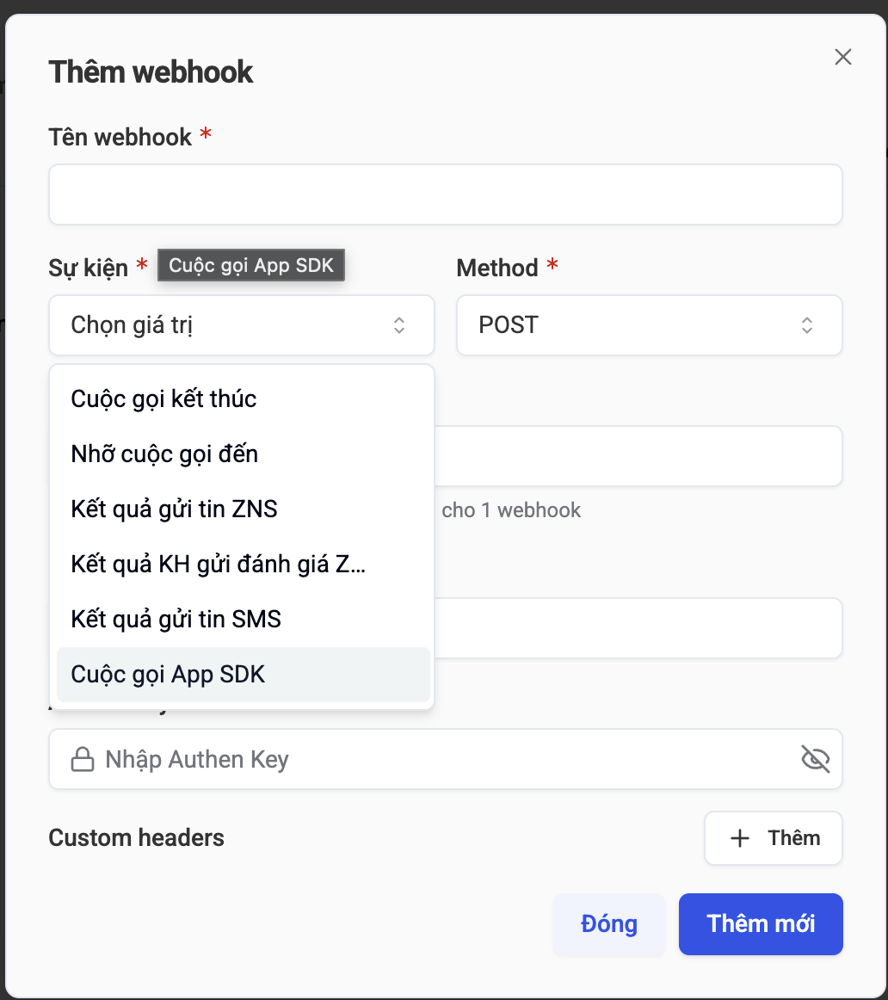

# Server mẫu: bắn push cuộc gọi (APNs VoIP + FCM)

Bắn push cuộc gọi thử tới máy thật, đúng payload server Zenify, để tách lỗi "server không gửi" với "app không xử lý". Không cần `npm install` (Node ≥ 18).

## Cần chuẩn bị

| Dùng cho | Cần | Lấy ở đâu |
| --- | --- | --- |
| iOS (APNs VoIP) | File key `AuthKey_<KeyID>.p8` + Key ID | developer.apple.com → Certificates, IDs & Profiles → **Keys** (key có bật APNs) |
| iOS (APNs VoIP) | Team ID | developer.apple.com → **Membership** |
| Android / iOS (FCM) | File service account JSON | Firebase Console → Project settings → **Service accounts** → Generate new private key |

Cấu hình bằng biến môi trường. Cách gọn nhất là file `.env` (script tự đọc; biến có sẵn trong shell được ưu tiên):

```sh
cd server
cp .env.example .env   # điền APN_KEY_FILE, APN_KEY_ID, APN_TEAM_ID, FCM_SERVICE_ACCOUNT_FILE
```

| Biến | Ý nghĩa |
| --- | --- |
| `APN_KEY_FILE` | Đường dẫn file `.p8` |
| `APN_KEY_ID` | Key ID (10 ký tự) |
| `APN_TEAM_ID` | Team ID Apple Developer (10 ký tự) |
| `APN_BUNDLE_ID` | Bundle id app (mặc định `com.example.sdk.zenify` của app demo; topic VoIP = bundle + `.voip`) |
| `APN_PRODUCTION` | `true` (mặc định): Ad Hoc / TestFlight. `false`: bản chạy từ Xcode. `--sandbox` ghi đè |
| `FCM_SERVICE_ACCOUNT_FILE` | Đường dẫn file service account JSON |

`.env` và `secrets/` đã nằm trong `.gitignore` — **không commit key**.

## Lệnh nhanh (`npm run …`)

Chạy trong `server/`. Tham số thêm đặt sau `--`.

| Lệnh | Làm gì |
| --- | --- |
| `npm start` | Chạy server `POST /push` (http://127.0.0.1:3000) |
| `npm run dev` | Như `start`, tự khởi động lại khi sửa code |
| `npm run webhook` | Nghe event cuộc gọi từ webhook.site rồi bắn push (xem mục Webhook) |
| `npm run health` | Kiểm tra server đang chạy (`GET /health`) |
| `npm run post` | Gửi `body.json` tới server đang chạy (chép từ `body.example.json`, điền token) |
| `npm run apns -- --token <voip_token>` | VoIP push iOS, production (Ad Hoc / TestFlight) |
| `npm run apns:sandbox -- --token <voip_token>` | VoIP push iOS, sandbox (bản chạy từ Xcode) |
| `npm run fcm -- --token <fcm_token>` | FCM Android `CALL_IN` |
| `npm run fcm:ios -- --type CALL_CANCEL --call-id <id> --token <fcm_token>` | Push im lặng iOS qua FCM |

Ví dụ đổ chuông 8s rồi huỷ: `npm run apns -- --token <voip_token> --cancel-after 8`.

Gửi body qua server:

```sh
cp body.example.json body.json   # điền "token"; body.json không commit
npm start                        # cửa sổ 1
npm run post                     # cửa sổ 2
```

## Server HTTP (POST /push)

```sh
npm start                # = node server.mjs — mặc định http://127.0.0.1:3000
PORT=4000 npm start      # đổi cổng (HOST để đổi địa chỉ nghe)
```

Chỉ nghe trên máy này (`127.0.0.1`) vì server cầm key APNs. Body:

```json
{
  "token": "<voip_push_token | fcm_token>",
  "os": "ios",
  "is_apn_prod": true,
  "payload": {
    "type": "CALL_IN",
    "tenant_id": "<tenant_id>",
    "agent_id": "<agent_id>",
    "phone_number": "0900000000",
    "uuid": "60902fa9-1e88-4c14-bb65-fb6c3e3a6a79",
    "call_id": "20260628004903-CUCEKDYB-2012",
    "callerName": "Khách hàng"
  }
}
```

| Trường | Ý nghĩa |
| --- | --- |
| `os: "ios"` | APNs VoIP, `payload` gửi nguyên vẹn. `is_apn_prod`: `true` = production, `false` = sandbox (bỏ trống = `APN_PRODUCTION`) |
| `os: "android"` | FCM data message ưu tiên cao |
| `channel: "fcm"` (tuỳ chọn, iOS) | Push im lặng qua FCM (dùng cho `CALL_CANCEL`), `token` là `fcm_token` |

**`payload` phải có `"type": "CALL_IN"`** (hoặc `CALL_CANCEL`). Thiếu `type` thì app báo cuộc ma, không đổ chuông — server trả kèm `warning`.

```sh
curl -s -X POST localhost:3000/push -H 'content-type: application/json' -d @body.json
```

Phản hồi: `ok`, `apns_status`, `apns_reason` (vd `BadDeviceToken`), `warning`. Xem bảng "Đọc kết quả APNs" bên dưới.

## Server làm webhook luôn (khuyên dùng)

Server **tự là webhook** — không cần webhook.site: web Zenify POST event cuộc gọi tới
`https://<domain>/<uuid>`, server bắn push **ngay** lúc nhận (không poll) và lưu lại để xem.

1. Tạo uuid (là "mật khẩu" của URL — ai có URL là bắn được push, đừng chia sẻ) rồi khai trong `.env`:
   ```sh
   node -e "console.log(crypto.randomUUID())"
   # .env: WEBHOOK_TOKENS=<uuid>          (nhiều uuid: cách nhau dấu phẩy)
   ```
2. Chạy server ở nơi có URL HTTPS công khai (đặt sau reverse proxy), nghe mọi địa chỉ:
   ```sh
   HOST=0.0.0.0 PORT=3000 npm start    # hoặc Docker — xem "Chạy bằng Docker"
   ```
3. Web Zenify → Webhook → **Thêm webhook**: Sự kiện **Cuộc gọi App SDK**, Method `POST`,
   URL `https://<domain>/<uuid>`, Authen Key là một chuỗi bí mật.

   

4. `.env`: `WEBHOOK_AUTH_KEY=<Authen Key>`. Request thiếu / sai key bị `401`. Key nằm ở header
   `authorization` (dạng `<key>` hoặc `Bearer <key>`); header khác thì đặt `WEBHOOK_AUTH_HEADER`.

| Đường dẫn | Dùng cho |
| --- | --- |
| `ANY /<uuid>` | Nhận event (body giống `POST /push`) → bắn push, trả kết quả (`ok`, `apns_status`…) |
| `GET /view/<uuid>` | Trang xem request đã nhận + kết quả bắn push, tự làm mới 3 giây |
| `GET /token/<uuid>/requests` | Cùng API JSON với webhook.site (`?per_page=`, `?sorting=oldest`) |
| `POST /push` | Bắn push trực tiếp (vẫn giữ, cùng Authen Key) |

- uuid không có trong `WEBHOOK_TOKENS` → `404`.
- Event thiếu `payload.type` → tự thêm `"type": "CALL_IN"`. Không phải JSON / thiếu `token` hoặc
  `payload` → bỏ qua (vẫn lưu để xem).
- Event lặp (cùng `call_id` + `token` + `type` trong `DEDUPE_SECONDS`) không bắn lại; mỗi vòng quay
  số mới (`CALL_IN` → `CALL_CANCEL` → `CALL_IN`…) vẫn bắn.
- Lịch sử giữ `WEBHOOK_KEEP` request mỗi uuid (mặc định 200), **trong bộ nhớ**: khởi động lại là mất.
  Header xác thực (`authorization`, cookie) không được lưu.

Server đọc trường `os` của event: `ios` → APNs VoIP, `android` → FCM (bảng dưới).

## Webhook qua webhook.site (tuỳ chọn — chưa có máy chủ công khai)

Dùng được webhook.site hoặc bản tự host cùng API (`GET /token/<uuid>/requests`): script đọc API ở
đúng host của `WEBHOOK_URL`.

Server Zenify POST event cuộc gọi tới URL webhook.site. `npm run webhook` đọc request **mới** qua API
webhook.site (2 giây / lần, không cần mở cổng ra Internet) rồi bắn push theo trường `os`:

| `os` | Gửi qua |
| --- | --- |
| `ios` | APNs VoIP (`is_apn_prod`: production / sandbox, mặc định theo `APN_PRODUCTION`) |
| `android` | FCM data message ưu tiên cao |

Body event giống `POST /push`:

```json
{ "token": "<voip / fcm token>", "os": "ios", "is_apn_prod": true,
  "payload": { "tenant_id": "…", "agent_id": "…", "phone_number": "…", "uuid": "…", "call_id": "…", "callerName": "…" } }
```

- Event thiếu `payload.type` → tự thêm `"type": "CALL_IN"` (app chỉ đổ chuông khi có `type`).
- Request không phải JSON / thiếu `token` hoặc `payload` → bỏ qua, có log.
- Event cũ **không** bắn lại:
  - request tạo **trước** lúc chạy script, so theo `created_at` nên vẫn đúng khi lần đọc đầu lỗi
    (`-- --replay` để bắn lại cả request đã có);
  - request cũ hơn `WEBHOOK_MAX_AGE` giây (mặc định 60, `0` = không giới hạn; hoặc `-- --max-age`).
    Vd mạng lỗi vài phút rồi đọc bù: cuộc gọi đã qua, không đổ chuông nữa;
  - event **lặp**: cùng `call_id` + `token` và cùng `type` với lần bắn trước của cuộc đó, trong
    `DEDUPE_SECONDS` (mặc định 600). Zenify quay số nhiều vòng với cùng `call_id`
    (`CALL_IN` → `CALL_CANCEL` → `CALL_IN` → `CALL_CANCEL`): mỗi lần đổi `type` vẫn bắn. Áp dụng cả
    `POST /push` (trả `{"ok": true, "skipped": "duplicate"}`). Bắn lỗi thì không tính, gửi lại được.
- `-- --dry-run`: chỉ in event sẽ bắn, không gửi push (kiểm tra trước khi chạy thật).
- Chỉ chạy **một** `npm run webhook` cho mỗi URL: hai tiến trình cùng đọc thì mỗi event bị bắn hai lần.

```sh
# .env: WEBHOOK_URL=https://webhook.site/<uuid>
npm run webhook
npm run webhook -- --url https://webhook.site/<uuid> --interval 1
```

## Chạy & test ở máy (không cần Docker)

Container Docker chạy đúng `node server.mjs` (Node 22) với biến môi trường — chạy thẳng bằng Node
(≥ 20.12) là test được gần hết, kể cả key APNs / FCM thật. `.env` ở thư mục `server/` được tự đọc.

```sh
cd server
U=$(node -e "console.log(crypto.randomUUID())")     # uuid webhook dùng để test
WEBHOOK_TOKENS=$U WEBHOOK_AUTH_KEY=test-key npm start  # log in URL webhook + URL xem
```

Ở terminal khác — gán lại `U` bằng uuid in trong log (`webhook: http://…/<uuid>`):

```sh
U=<uuid>
```


```sh
curl -s localhost:3000/health                                          # {"ok": true}
curl -s -o /dev/null -w "%{http_code}\n" -X POST localhost:3000/$U -d '{}'   # 401: thiếu Authen Key

# Kiểm tra key mà KHÔNG làm máy nào đổ chuông: token giả → APNs / FCM thật trả lỗi token
curl -s -X POST localhost:3000/$U -H 'authorization: test-key' -H 'content-type: application/json' \
  -d '{"token":"0000000000000000000000000000000000000000000000000000000000000000","os":"ios","is_apn_prod":false,"payload":{"type":"CALL_IN","call_id":"TEST-1"}}'
# → apns_status 400 + BadDeviceToken = key .p8 / Key ID / Team ID đúng (key sai → 403)
curl -s -X POST localhost:3000/$U -H 'authorization: test-key' -H 'content-type: application/json' \
  -d '{"token":"fake-fcm-token","os":"android","payload":{"type":"CALL_IN","call_id":"TEST-2"}}'
# → fcm_status 400 INVALID_ARGUMENT = service account Firebase đúng (sai → lỗi lấy OAuth token)

# Máy thật đổ chuông: thay token thật (voip_token iOS / fcm_token Android). App chạy từ Xcode /
# flutter run → "is_apn_prod": false; Ad Hoc / TestFlight → true
curl -s -X POST localhost:3000/$U -H 'authorization: test-key' -H 'content-type: application/json' \
  -d '{"token":"<token>","os":"ios","is_apn_prod":false,"payload":{"type":"CALL_IN","call_id":"TEST-3","phone_number":"0900000000"}}'
```

Xem các request vừa gửi + kết quả bắn push: mở `http://localhost:3000/view/$U` (hoặc JSON:
`curl -s localhost:3000/token/$U/requests`).

| Kết quả | Ý nghĩa |
| --- | --- |
| `200`, `ok: true` | Đã gửi tới APNs / FCM |
| `401` | Thiếu / sai `WEBHOOK_AUTH_KEY` |
| `404` | uuid không có trong `WEBHOOK_TOKENS` |
| `skipped: "duplicate"` | Event lặp đã bắn thành công trước đó (gửi lỗi thì không tính, gửi lại được) |
| `apns_status` / `fcm_status` khác 200 | Xem "Đọc kết quả APNs" bên dưới |

Docker chỉ thêm phần build image, đọc `.env` qua `env_file` và mount `./secrets` — test bằng mục
dưới khi máy có Docker (macOS: Docker Desktop, hoặc `brew install colima docker docker-compose && colima start`).

## Chạy bằng Docker

Image chỉ chứa code (Node 22, không cần `npm install`). Bí mật **không** nằm trong image
(`.dockerignore` chặn `.env`, `secrets/`, `*.p8`): biến truyền qua `.env`, key mount vào
`/secrets` lúc chạy.

```sh
cp .env.example .env                 # điền APN_*, FCM_*, WEBHOOK_TOKENS, WEBHOOK_AUTH_KEY
mkdir -p secrets && cp AuthKey_XXXXXXXXXX.p8 firebase-service-account.json secrets/
# trong .env trỏ đường dẫn TRONG container:
#   APN_KEY_FILE=/secrets/AuthKey_XXXXXXXXXX.p8
#   FCM_SERVICE_ACCOUNT_FILE=/secrets/firebase-service-account.json

docker compose up -d --build         # một service: webhook /<uuid> + POST /push, cổng 3000
docker compose logs -f               # in URL webhook lúc khởi động + kết quả bắn push
curl -s localhost:3000/health
```

Web Zenify trỏ webhook tới `https://<domain>/<uuid>`; xem request ở `https://<domain>/view/<uuid>`.

Không dùng compose:

```sh
docker build -t zenify-push .
docker run -d --name zenify-push --env-file .env -v "$PWD/secrets:/secrets:ro" \
  -p 127.0.0.1:3000:3000 zenify-push
```

* Container nghe `0.0.0.0` (đặt sẵn `HOST`), cổng chỉ publish ra `127.0.0.1` của máy chủ (đổi cổng:
  `SERVER_PORT`). Server Zenify phải gọi tới được → đặt sau reverse proxy HTTPS, và **nên** đặt
  `WEBHOOK_AUTH_KEY` — server cầm key APNs / FCM.
* Vẫn muốn đọc từ webhook.site bên ngoài: `docker run … zenify-push node webhook.mjs`
  (cần `WEBHOOK_URL`). Đừng chạy cùng lúc với webhook `/<uuid>` cho cùng nguồn event — máy nhận
  push 2 lần.

## Lấy token

- **VoIP (iOS):** `voip_push_token` của agent (`GET /v2/me/agent-status` không có, xem `info.voip_push_token` lúc đăng nhập), hoặc đọc từ app.
- **FCM:** `fcm_token` (Android: token FCM, cũng nằm trong `voip_push_token`).

## Dùng

```sh
# iOS: VoIP push CALL_IN → CallKit đổ chuông (bản Ad Hoc / TestFlight = production)
node push.mjs apns --token <voip_token>
# … bản chạy từ Xcode / flutter run = sandbox
node push.mjs apns --token <voip_token> --sandbox
# đổ chuông 8s rồi huỷ (CALL_CANCEL qua VoIP)
node push.mjs apns --token <voip_token> --cancel-after 8

# Android: CALL_IN qua FCM (data message ưu tiên cao)
node push.mjs fcm --token <fcm_token>
node push.mjs fcm --token <fcm_token> --cancel-after 8

# iOS: CALL_CANCEL im lặng qua FCM (đường huỷ chính trên iOS)
node push.mjs fcm --platform ios --type CALL_CANCEL --call-id <call_id> --token <fcm_token_ios>
```

Tuỳ chọn: `--call-id`, `--number`, `--name`, `--type CALL_IN|CALL_CANCEL`, `--cancel-after <giây>`.

`call_id` giả không có SIP INVITE đi kèm: máy đổ chuông rồi tự tắt sau vài giây (zcore hết thời gian chờ INVITE). Như vậy là bình thường.

## Đọc kết quả APNs

| Phản hồi | Nghĩa |
| --- | --- |
| `HTTP 200` + máy đổ chuông | APNs và app đều đúng → nếu cuộc gọi thật không tới, lỗi ở server Zenify |
| `400 BadDeviceToken` | Sai môi trường: token sandbox gửi production hoặc ngược lại (thử thêm / bỏ `--sandbox`) |
| `400 DeviceTokenNotForTopic` | Token không thuộc `APN_BUNDLE_ID` |
| `403 InvalidProviderToken` | `APN_KEY_ID` / `APN_TEAM_ID` / file `.p8` không khớp |
| `410 Unregistered` | Token đã bị thu hồi (gỡ app, cài lại) |
| `200` nhưng máy im | Lỗi phía app: xem log `ZenifyCallKit` trong Console.app |
